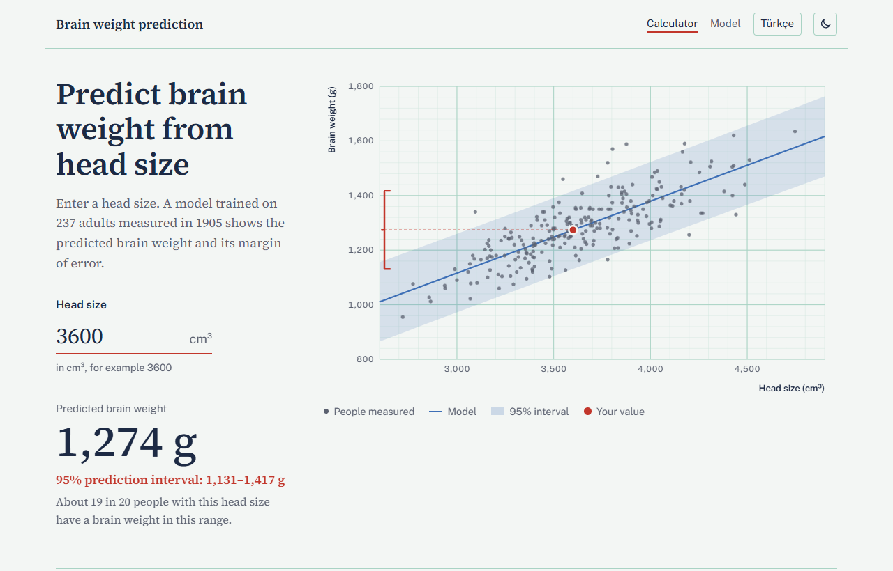
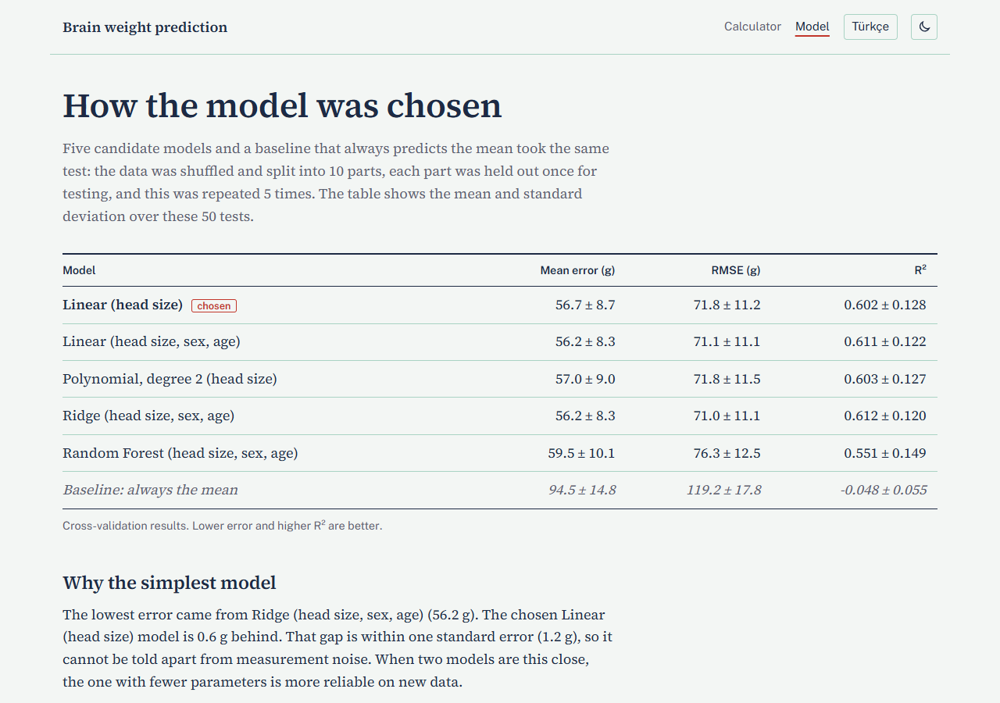
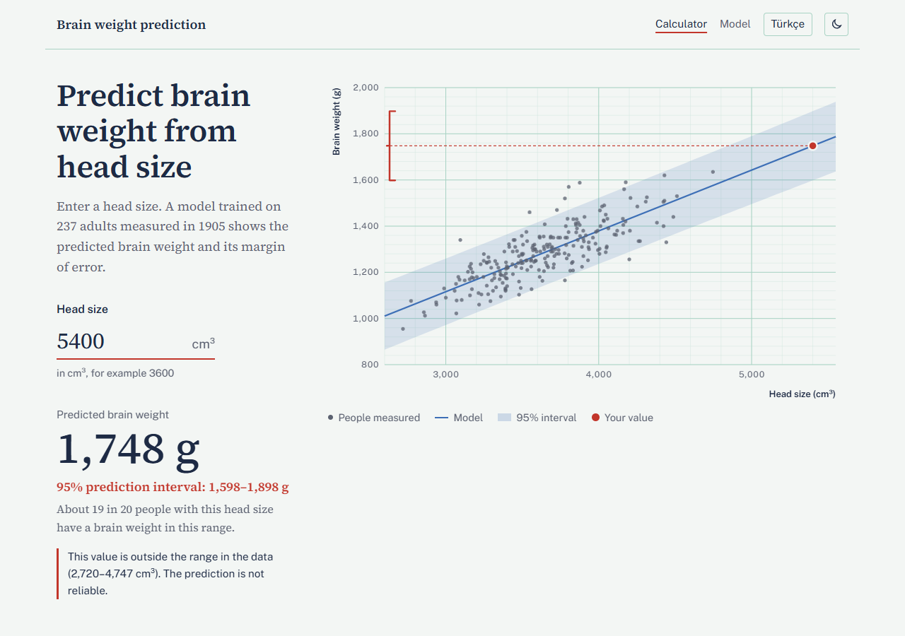
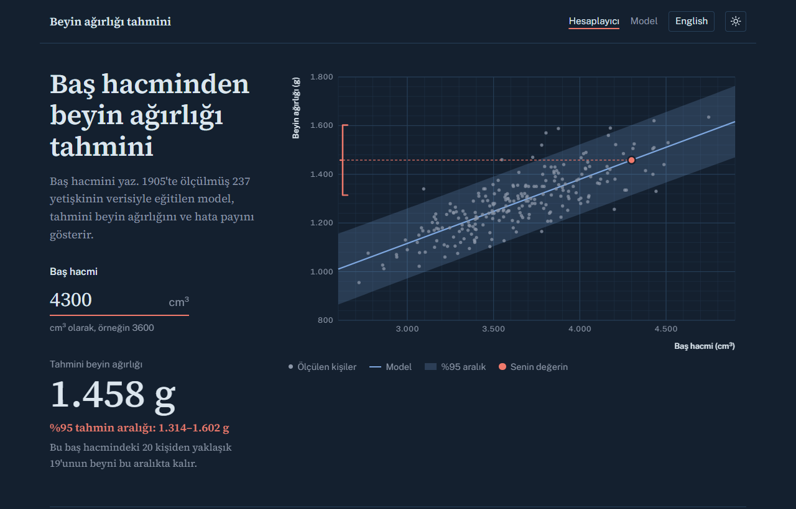
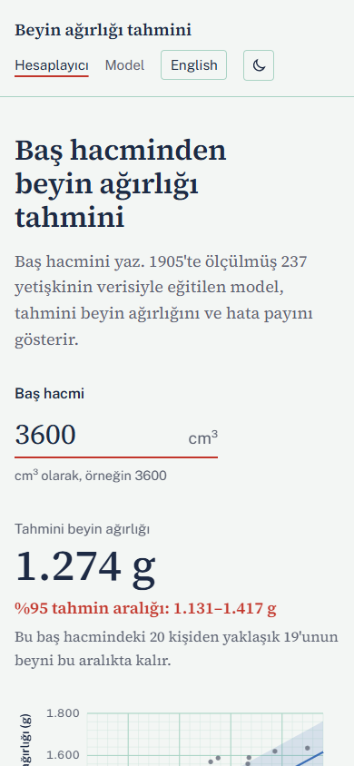

# Brain Weight Prediction

**English** | [Türkçe](README.tr.md)

A brain weight calculator: enter a head size in cm³ and get the predicted adult brain weight with a 95% prediction interval. A Python machine learning pipeline compares five regression models with repeated cross-validation, picks the simplest one that is as good as the best, and exports it to JSON; a small website runs the model in the browser.

**Live demo:** [brain.miracdeprem.com](https://brain.miracdeprem.com)



> **Not a medical tool.** The model is trained on a historical dataset of adults and is for learning and demonstration only.

## Features

**Website**
- Predicted brain weight with a 95% prediction interval ("about 19 in 20 people with this head size fall in this range")
- Chart on graph paper: the 237 people in the data, the regression line, the interval band and your value, with the interval drawn as a bracket on the axis
- A warning when the head size is outside the range of the data (2,720–4,747 cm³), and clear messages for invalid input ("3.600" and "3,600" are read as thousands)
- Model page: comparison table, why the model was chosen, residual plot and a model card (intended use, data, method, limits)
- Turkish and English on their own addresses (`/` and `/en/`), light and dark theme, works on phones and with the keyboard
- No server: predictions run in the browser from `model.json`, nothing is sent or stored

**Training pipeline**
- Validates the dataset before training (columns, codes, physically possible ranges) and reports the bad row numbers
- Compares five models and a mean-only baseline on the same 50 cross-validation splits
- Chooses with the one-standard-error rule: the simplest model whose error is within one standard error of the best
- Exports coefficients and everything the prediction interval needs, so the browser needs no statistics library
- Shared test fixtures prove that Python and JavaScript give the same predictions

## Screenshots

| | |
|---|---|
|  |  |



<p align="center"></p>

## How it works

```
data/gladstone-1905.csv ──► validate ──► compare 5 models ──► choose ──► export ──► web/model.json
                                         (10-fold CV × 5)    (1-SE rule)            web/metrics.json
                                                                                    web/data.json
                                                                                         │
browser: head size ──► validate input ──► mean ± t·σ·√(1 + xᵀ(XᵀX)⁻¹x) ──► result + chart
```

1. **Validate.** [`brainweight/data.py`](brainweight/data.py) checks columns, category codes and value ranges, and renames the raw columns.
2. **Compare.** [`brainweight/models.py`](brainweight/models.py) runs every candidate on the same `RepeatedKFold` splits (10 folds, 5 repeats). Preprocessing lives inside scikit-learn pipelines, so it is learned from the training folds only.
3. **Choose.** If a simpler model is within one standard error of the best, it wins.
4. **Export.** [`brainweight/export.py`](brainweight/export.py) fits the chosen model with least squares and writes the coefficients, σ, the t value, (XᵀX)⁻¹ and the training range.
5. **Predict.** [`web/src/predict.js`](web/src/predict.js) computes the same formula. The interval widens away from the centre of the data, where the model has seen fewer examples.

## Results

Repeated 10-fold cross-validation (50 splits), mean ± standard deviation:

| Model | Mean absolute error (g) | R² |
|---|---|---|
| **Linear (head size)**, chosen | 56.7 ± 8.7 | 0.602 ± 0.128 |
| Linear (head size, sex, age group) | 56.2 ± 8.3 | 0.611 ± 0.122 |
| Polynomial, degree 2 (head size) | 57.0 ± 9.0 | 0.603 ± 0.127 |
| Ridge (head size, sex, age group) | 56.2 ± 8.3 | 0.612 ± 0.120 |
| Random Forest (head size, sex, age group) | 59.5 ± 10.1 | 0.551 ± 0.149 |
| Baseline (always the mean) | 94.5 ± 14.8 | −0.048 ± 0.055 |

Ridge was best by 0.55 g, which is within one standard error, so the one-variable line was chosen: brain weight ≈ 325.6 + 0.2634 × head size, σ ≈ 72 g.

## Dataset

237 adults: head size (cm³), brain weight (g), sex and age group (20–46, 46+). Source: R. J. Gladstone, "A Study of the Relations of the Brain to the Size of the Head", *Biometrika* IV, 1905. The model is valid for adults only.

## Tech Stack

- **Python**, **pandas**, **NumPy**, **scikit-learn**, **SciPy** for training and evaluation
- **HTML**, **CSS** and **JavaScript** with no framework and no build step; the chart is hand-written SVG
- **pytest** and Node's built-in test runner (`node --test`)
- **Vercel** for hosting, with a strict Content Security Policy

## Installation

Open [brain.miracdeprem.com](https://brain.miracdeprem.com), or run it locally with Python and Node.js:

```bash
git clone https://github.com/MrcDprm/brain-weight-prediction.git
cd brain-weight-prediction
python -m venv .venv
.venv/Scripts/activate          # Windows; on macOS/Linux: source .venv/bin/activate
pip install -r requirements-dev.txt
```

Train, compare and export (writes `web/model.json`, `web/metrics.json` and `web/data.json`), then refresh the shared test fixtures:

```bash
python -m brainweight.train
python -m brainweight.fixtures
```

Run the tests and the website:

```bash
python -m pytest
npm test
python -m http.server 8000 -d web   # then open http://localhost:8000
```

The HTML pages, `sitemap.xml` and `robots.txt` are generated from `web/pages/` and `web/src/messages.js` in both languages. After changing a text, run `npm run build:pages`; a test fails if the pages are out of date.

## Project Structure

```
brainweight/   data validation, model comparison, export, training command
tests/         pytest tests
data/          the original dataset
scripts/       build-pages.mjs: generates the Turkish and English pages
web/           the website (Vercel serves this folder)
  pages/       page templates
  src/         predict.js, chart.js, app.js, model-page.js, messages.js, theme.js
  tests/       JavaScript tests and shared fixtures
```

## What I Learned

- A single train/test split can flatter a model. The old version of this project reported R² 0.66 from one lucky split; with repeated cross-validation it is 0.60.
- My first cross-validation gave 0.46 because the CSV is sorted by sex and age, and I split it without shuffling. Some test folds held only one group. Shuffling the data before splitting is not optional.
- The old project called this "baby brain weight", but the average brain in the data weighs 1,283 g, which is an adult brain. Checking the data against what you know about the subject comes before any model.
- More complex models did not help. Sex and age add almost nothing once head size is known, and Random Forest overfits on 237 rows. The one-standard-error rule gave me a principled reason to keep the simplest model.
- A prediction without an error margin is misleading. I learned the difference between a confidence interval (for the line) and a prediction interval (for one person), and why the interval widens at the edges of the data.
- Exporting a model as plain numbers instead of a pickle file made it readable, safe to load and usable from JavaScript. Shared fixtures keep the two languages in step.
- Drawing a chart in SVG by hand taught me scales, nice tick steps and how to keep text readable on phones.

## Future Plans

- Tape-measure mode (head length, width and height → head size), once the exact measurement method behind the dataset's head size values is confirmed from the original paper.
- Batch prediction from an uploaded CSV file.
- Additional datasets.
- Bayesian regression for uncertainty estimates.

## License

[MIT](LICENSE)
